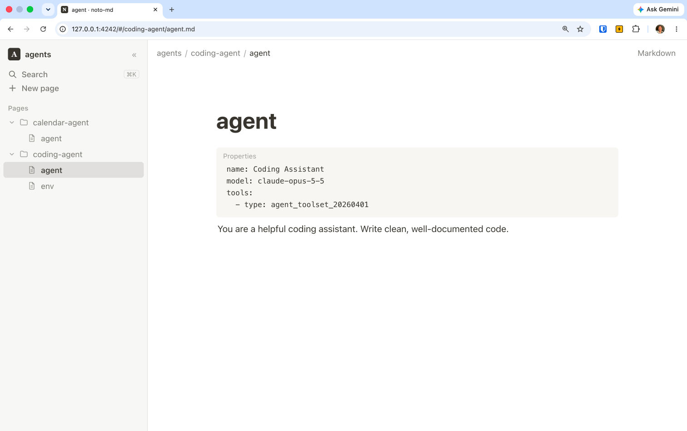

# noto-md

[](https://www.npmjs.com/package/noto-md)

A Notion-style editor for a folder of Markdown files. Run one command and your
`.md` files open in the browser as editable blocks: a page tree on the left and
a block editor on the right. Every edit is written straight back to the file on
disk.

```bash
npx noto-md ./my-notes
```



- **No setup, no database.** Your files stay plain Markdown that you can still
  edit with any other tool and commit to git.
- **Doesn't reformat your files.** noto-md only rewrites the blocks you change.
  Everything else in the file is saved back byte-for-byte, so git diffs show
  just your edits.
- **Zero dependencies.** It needs Node.js 20+ and nothing else.

---

## Install

Requires Node.js 20 or newer.

Run it once without installing:

```bash
npx noto-md ./my-notes
```

Or install it globally to get the `notomd` command (`noto-md` works too):

```bash
npm install -g noto-md
```

```bash
notomd ./my-notes
```

To update later:

```bash
npm update -g noto-md
```

## Usage

```bash
notomd [path] [options]
```

| Argument / option | Description |
| --- | --- |
| `path` | Folder to open (defaults to the current folder). You can also pass a single `.md` file to open its folder with that page selected. |
| `-p, --port <n>` | Port to use. Defaults to 4242, or the next free port. |
| `--no-open` | Don't open a browser tab automatically. |
| `-h, --help` | Show help. |
| `-v, --version` | Show the version. |

The server listens only on `127.0.0.1`. Press `Ctrl+C` to stop it.

## The interface

### Sidebar

- Shows every `.md` / `.markdown` file in the folder, nested by subfolder.
  Folders that contain no Markdown are hidden, as are dot-folders (`.git`, …)
  and `node_modules`.
- Click a folder to expand it. Hover a folder and click **+** to create a page
  inside it.
- Hover a page and click the pencil to rename it.
- **New page** creates a file at the top level. Type `folder/name` to create it
  inside a folder (missing folders are created).
- `⌘\` (`Ctrl+\`) hides or shows the sidebar.

### Page

- The big title is the file name. Click it and type to rename the file.
- The breadcrumb at the top shows where the file is.
- **Markdown** (top right) switches to the raw source of the page; **Blocks**
  switches back. Both edit the same file. `⌘⇧M` toggles.
- A small status in the top bar reads *Saving…* or *Saved*. Changes save
  automatically about half a second after you stop typing. `⌘S` saves
  immediately.

### Search

`⌘K` or `⌘P` opens search. It matches page names as you type and also searches
inside every page. Picking a content match jumps to and highlights that block.

## Editing blocks

Every paragraph, heading, list item and so on is a block. Click any text to
edit it.

### Supported blocks

| Block | Markdown it reads and writes |
| --- | --- |
| Text | plain paragraphs |
| Heading 1–3 (4–6 are displayed too) | `#`, `##`, `###` (and `===` / `---` underlined headings) |
| Bulleted list | `- item`, `* item`, `+ item`, with nesting |
| Numbered list | `1. item`, `1) item`, with nesting |
| To-do list | `- [ ] task` / `- [x] done` |
| Quote | `> text` |
| Callout | GitHub alerts: `> [!NOTE]`, `[!TIP]`, `[!IMPORTANT]`, `[!WARNING]`, `[!CAUTION]` |
| Code | fenced blocks (```` ``` ```` or `~~~`) with a language label |
| Divider | `---`, `***`, `___` |
| Table | GitHub tables, including column alignment |
| Image | a paragraph that is only `` |
| HTML | raw HTML blocks, shown as a safe preview (scripts never run) |
| Properties | YAML front matter (`---` … `---`) at the top of a file |

Inline formatting: **bold**, *italic*, ~~strikethrough~~, `code`, links, and
inline images. Anything noto-md doesn't understand is kept as literal text, so
it survives untouched.

### Creating and changing blocks

- **Type `/`** at the start of a line (or after a space) to open the block
  menu. Keep typing to filter it (`/todo`, `/h2`, `/code`, …), then press
  `Enter`.
- **Markdown shortcuts** work at the start of a text block:

  | Type | Get |
  | --- | --- |
  | `# ` / `## ` / `### ` | Heading 1 / 2 / 3 |
  | `- ` or `* ` | Bulleted list |
  | `1. ` | Numbered list |
  | `[] ` or `[x] ` | To-do |
  | `> ` | Quote |
  | ```` ``` ```` | Code block |
  | `---` | Divider |

- **Hover a block** to show two handles on its left:
  - **+** adds a block below and opens the `/` menu. Alt-click it to add a
    block above instead.
  - **⋮⋮** opens the block menu (*Delete*, *Duplicate*, *Move up/down*,
    *Turn into…*). Drag it to move the block.
- **Select text** to get a formatting toolbar: Turn into, Bold, Italic,
  Strike, Code, Link.
- **Paste** multi-line Markdown and it becomes real blocks.

### Keyboard shortcuts

| Keys | Action |
| --- | --- |
| `Enter` | New block (lists continue the list) |
| `Enter` on an empty list item | Outdent, then turn into text |
| `Shift+Enter` | Line break inside a block |
| `Backspace` at the start | Turn the block into text, then merge it into the block above |
| `Delete` at the end | Pull the next block into this one |
| `Tab` / `Shift+Tab` | Indent / outdent a list item |
| `↑` `↓` `←` `→` | Move between blocks |
| `⌘B` `⌘I` `⌘E` `⌘⇧S` | Bold, italic, inline code, strikethrough |
| `⌘K` | Add or edit a link (in text); open search (elsewhere) |
| `⌘`-click a link | Open it. Links to other `.md` files open in noto-md, and `#heading` links scroll to the heading |
| `⌘Enter` | Toggle a to-do; in other blocks, start a new block below |
| `⌘⌥0` … `⌘⌥8` | Turn into text, H1–H3, to-do, bullets, numbers, (8) code |
| `⌘D` | Duplicate block |
| `⌘⇧↑` / `⌘⇧↓` | Move block up / down |
| `⌘Z` / `⌘⇧Z` | Undo / redo (covers structural changes too) |

On Windows and Linux, use `Ctrl` in place of `⌘` and `Alt` in place of `⌥`.

#### Code blocks

`Enter` inserts a new line and keeps the indentation. `Tab` inserts two spaces.
Use `⌘Enter` or `↓` on the last line to leave the block. Click the language
label to change it.

#### Tables

`Tab` moves to the next cell, and pressing it in the last cell adds a row.
`Enter` moves down a row. Hover the table for **+ Row**, **+ Column**,
**− Row** and **− Column**, which act on the cell you last focused.

#### Images

Click an image (or an empty image block) to edit its path or URL and its
caption. Relative paths resolve from the page's folder, just as on GitHub.

## Working alongside other editors

noto-md watches the folder:

- New, renamed and deleted files show up in the sidebar right away.
- If the open page changes on disk while you have no unsaved edits, it reloads
  automatically.
- If it changes while you're also editing, a banner lets you choose **Load the
  version on disk** or **Keep mine**. noto-md never silently overwrites a
  change it hasn't seen.

## How files are saved

Each file is parsed into blocks, and each block remembers its exact original
text and the blank lines that followed it. On save:

- Blocks you didn't touch are written back exactly as they were.
- Blocks you edited are regenerated as standard Markdown (`-` bullets, `#`
  headings, fenced code, padded tables).
- New blocks get normal spacing, with lists kept tight.
- Line endings (LF or CRLF) are preserved.

If some unusual syntax doesn't round-trip the way you'd like, switch to the
**Markdown** view and edit the source directly.

## Security

noto-md is a local tool and is built to stay local:

- It binds to `127.0.0.1` only, and it rejects requests whose `Host` or
  `Origin` isn't its own. This blocks other websites and DNS-rebinding
  attacks from reaching your files.
- All file access is confined to the folder you opened, including through
  symlinks, and only Markdown files can be written.
- Markdown is rendered without executing anything. HTML blocks are previewed in
  a sandboxed frame with scripts disabled. Workspace files are served with a
  sandbox CSP, and the app itself runs under a strict Content-Security-Policy.

## Development

```text
bin/notomd.js        CLI entry: argument parsing, starts the server, opens the browser
src/server.js        HTTP server: tree, read/write, rename, search, file watching (SSE)
public/index.html    App shell
public/app.css       Styles (light and dark)
public/js/
  markdown.js        Block parser and serializer (lossless round-trips)
  inline.js          Inline Markdown <-> editable HTML
  editor.js          The block editor: rendering, keyboard, slash menu, drag and drop, undo
  caret.js           Caret and selection helpers
  menu.js            Floating menu used by the slash and block menus
  app.js             Sidebar, routing, autosave, search, live reload
test/                node:test suite for the parser
```

There is no build step. The browser loads the ES modules as they are.

```bash
git clone <this repo> && cd noto-md
npm link            # puts your local checkout on PATH as `notomd`
npm test            # parser round-trip tests
npm start -- ./docs # run against a folder
```

To publish a new version:

```bash
npm version patch   # or minor / major
npm publish
```

## Limitations

- Files are opened as UTF-8.
- Deleting pages is left to your file manager or `git`, on purpose.
- Some Markdown is preserved but shown as plain text rather than rendered:
  reference-style links, footnotes, math, and list items spanning several
  paragraphs.
- Nested content inside a quote (lists or code inside `>`) is edited as text.
